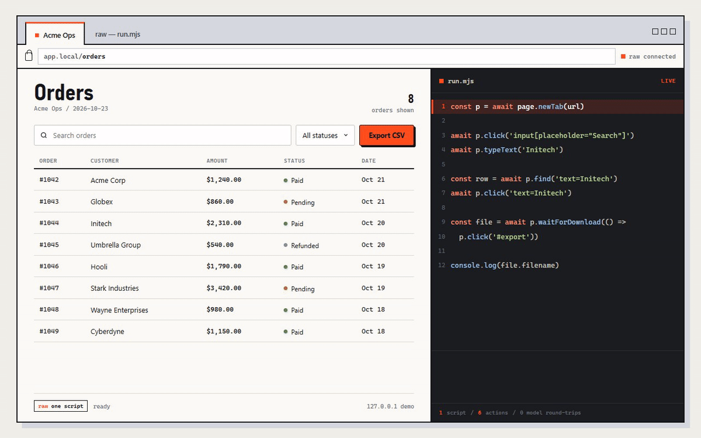
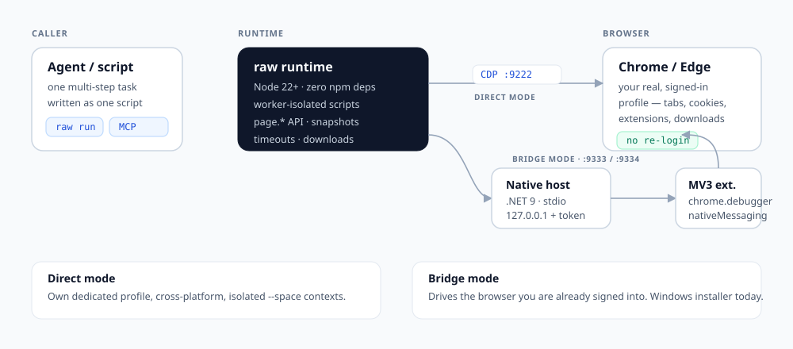

# raw-browser (raw)

**Drive the Chrome or Edge you're already signed into — from one script.**

A zero-dependency browser automation runtime, CLI and MCP server for AI agents.
No fresh profile, no re-login, no `click → look → click` loop.

[](https://github.com/liutingqiu/raw-browser/actions/workflows/ci.yml)
[](https://github.com/liutingqiu/raw-browser/releases)
[](https://nodejs.org/)
[](LICENSE)

English | [简体中文](README.zh-CN.md)



*The demo is one script: snapshot, click, type, select, export. [MP4 version](assets/demo.mp4).*

---

## What it is

- **A browser, not a new browser.** The extension bridge attaches to the Chrome or
  Edge profile you already use — sessions, cookies and extensions included.
- **One script, one task.** A multi-step job is a single JavaScript program with
  loops, conditions and waits, instead of one model round-trip per click.
- **A browser tool layer.** CLI, scripting runtime and a stdio MCP server exposing
  27 tools: navigation, reading, input, waiting, screenshots and browser surfaces.

It does browser work only. It is not a task orchestrator, not a terminal manager
and not a model.

## Quick start

Requires **Node.js 22.21+** and Chrome or Edge.

```bash
npm install -g raw-browser
raw status
raw run -e "const p = await page.newTab('https://example.com'); console.log(await p.title()); await p.closeTab()"
```

In direct CDP mode the first run launches a dedicated browser profile under
`~/.raw/` and keeps it across runs, so logins survive.

From source instead:

```bash
git clone https://github.com/liutingqiu/raw-browser.git
cd raw-browser
npm install
npm run build
npm link
raw status
```

Pinned or offline installs can use the `raw-browser.tgz` tarball attached to each
[release](https://github.com/liutingqiu/raw-browser/releases/latest). The
extension bridge installer ships in both the npm package and a clone; a global
install runs it with
`node "$(npm root -g)/raw-browser/scripts/install-edge-bridge.mjs"`.

## One script, one task

```js
const p = await page.newTab('https://app.example.com/orders');

const snapshot = await p.snapshot({ scope: 'viewport' });
console.log(snapshot);                       // numbered elements: [0], [1], …

await p.click('role=button[name="Search"]');
await p.fill('role=textbox', 'Initech');
await p.click('text=Initech');

const file = await p.waitForDownload(() => p.click('text=Export CSV'));
console.log(file.path);                      // orders.csv is on disk
await p.closeTab();
```

Run it from a file:

```bash
node dist/browser-cli.js run < demo/example.mjs
```

or inline:

```bash
raw run -e "const p = await page.newTab('example.com'); console.log(await p.snapshot()); await p.closeTab()"
```

## What's inside

| Area | Capabilities |
|---|---|
| **Locators** | snapshot indices (`#12`), CSS, XPath, `text=`, `:has-text()`, `role=…[name=…]`; open shadow DOM and same-origin iframes |
| **Input** | real CDP mouse/keyboard events, button bitmasks, interpolated drag paths, key chords, file inputs |
| **Rich editors** | Monaco, CodeMirror 5/6, contenteditable and React-controlled fields, with the strategy reported |
| **Waiting** | navigation, popups, downloads, file choosers, DOM mutations, network responses, functions and URLs |
| **Reading** | numbered snapshots, accessibility tree, text/HTML, frames (cross-origin included) |
| **Browser surfaces** | tabs, cookies, proxy, history, bookmarks, extensions, downloads, notifications, CSS injection |
| **Isolation** | `--space` creates a browser context with its own cookies, cache and storage (direct CDP mode) |
| **Agent integration** | CLI, a JavaScript scripting API, and an MCP server with 27 tools |

See [docs/API.md](docs/API.md) for the full scripting reference.

## How it works



There are two ways to reach a browser:

1. **Direct CDP** — `raw` launches a dedicated Chromium profile with
   `--remote-debugging-port` (default `9222`). Cross-platform, isolated spaces,
   no extension required.
2. **Extension bridge** — an MV3 extension uses `chrome.debugger` on real tabs,
   talks to a .NET native-messaging host over stdio, and the host exposes a
   token-protected CDP facade on loopback. Edge uses `9333`, Chrome uses `9334`.
   This is what drives your signed-in profile.

The bridge listener binds to `127.0.0.1` only, requires a per-browser random
token, validates the `Host` header, and refuses a debug port it does not own.
The extension does not copy or log cookies on its own; cookie values are
returned only when a script explicitly calls a cookie API.

## Drive your signed-in browser

The bridge installer supports Windows, macOS and Linux. Direct CDP mode also
works on all three.

```bash
# global npm install (macOS / Linux)
node "$(npm root -g)/raw-browser/scripts/install-edge-bridge.mjs" --browser both

# source checkout (any platform)
node scripts/install-edge-bridge.mjs --browser both
```

On Windows the same Node command delegates to the PowerShell installer. You can
also run that script directly:

```powershell
powershell -ExecutionPolicy Bypass -File "$(npm root -g)\raw-browser\scripts\install-edge-bridge.ps1" -Browser both
```

The installer publishes a self-contained native host, writes independent tokens
to `~/.raw/edge-bridge.json` and `~/.raw/chrome-bridge.json`, and registers the
selected native-messaging hosts: HKCU on Windows,
`NativeMessagingHosts` under `~/Library/Application Support` on macOS, and under
`~/.config` on Linux. If the .NET 9 SDK is missing, it downloads the matching
prebuilt host from [Releases](https://github.com/liutingqiu/raw-browser/releases)
and verifies `SHA256SUMS.txt` when available. Use `--host-path` to install a
host you built yourself, or `--build-from-source` to force a local build.

The host always lives at `~/.raw/edge-bridge/current/` so the native-messaging
manifest does not move between upgrades; the installer replaces the executable
in place and keeps the previous pair for rollback.

The browser and the host must be in the same operating system. A Windows Chrome
cannot use a host installed in WSL: use the Windows installer for the Windows
browser, or install a Linux Chrome/Edge inside WSL (with WSLg) and run this
installer there. Snap- and Flatpak-confined browsers do not read the
user-level native-messaging directory the installer writes; use a deb/rpm or
app-bundle install for the bridge.

Then load the unpacked extension once per browser:

1. Open `edge://extensions` or `chrome://extensions`.
2. Enable **Developer mode**.
3. Choose **Load unpacked** and select the path printed as `ExtensionPath` (in a
   clone it is `edge-bridge/extension`).

Select the bridge in `~/.raw/browser-profiles/current.json`:

```json
{ "mode": "edge-extension" }
```

or `{ "mode": "chrome-extension" }`. `raw status` prints the selected bridge,
port and extension version. If the bridge does not connect after an upgrade,
restart the browser once: it caches the native-messaging host path for the life
of the process. Upgrading from an older installer? Restart the browser, then run
the installer once with `--clean-legacy-hosts` (`-CleanLegacyHosts` in
PowerShell) to remove the old `host-*` directories.

## CLI

| Command | Description |
|---|---|
| `raw status` | show the debugger, bridge, profile and browser binary |
| `raw run` | read a script from stdin |
| `raw run -e "<code>"` | run an inline script |

| Option | Description |
|---|---|
| `--timeout-ms N` | script timeout (default `180000`) |
| `--space NAME` | run in an isolated browser context (direct mode) |
| `--headless` | launch headless when the browser is not already running |
| `--profile PATH` | override the persistent profile directory |
| `--port N` | override the CDP port |
| `--browser PATH` | use a specific Chrome or Edge executable |
| `--downloads PATH` | override the download directory |
| `--output-dir PATH` | where inline images are written |

There is also `raw-bridge.mjs`, the single-command JSON facade the MCP server
drives (`tabs`, `goto`, `eval`, `snapshot`, `click`, `fill`, `press`, `scroll`,
`screenshot`, `cookies`, `frames`, `call`, …). Every command prints JSON and
sets a meaningful exit code.

## MCP server

`npm install -g raw-browser` also installs `raw-mcp`, a stdio MCP server that
exposes the runtime as 27 tools:

`raw_use`, `raw_status`, `raw_tabs`, `raw_claim`, `raw_release`, `raw_close`,
`raw_clone`, `raw_approve`, `raw_new`, `raw_goto`, `raw_text`, `raw_html`,
`raw_eval`, `raw_snapshot`, `raw_click`, `raw_fill`, `raw_press`, `raw_select`,
`raw_scroll`, `raw_wait`, `raw_group`, `raw_run`, `raw_visit`, `raw_screenshot`,
`raw_cookies`, `raw_frames`, and the `raw_call` escape hatch.

```json
{
  "mcpServers": {
    "raw-browser": {
      "type": "stdio",
      "command": "raw-mcp",
      "env": { "RAW_BRIDGE_BROWSER": "edge" }
    }
  }
}
```

From a source checkout, point the client at `mcp/raw-browser-mcp.mjs` instead:

```json
{
  "mcpServers": {
    "raw-browser": {
      "type": "stdio",
      "command": "node",
      "args": ["C:/path/to/raw-browser/mcp/raw-browser-mcp.mjs"],
      "env": { "RAW_BRIDGE_BROWSER": "edge" }
    }
  }
}
```

The server remembers the current tab, returns screenshots as image content,
serializes tool calls, and supports cancellation. Set `RAW_CLI` when
`raw-bridge.mjs` is not next to the server, and `RAW_BRIDGE_BROWSER=edge|chrome`
to pick a bridge. The server is registered in the
[HOL Guard](https://github.com/hashgraph-online/hol-guard) MCP catalog as
`mcp.raw-browser`: read-only tools inherit normal policy, navigation, input and
cookie reads are reviewed, and `raw_eval` / `raw_call` are blocked.

### Tab ownership

Several agents can share one browser without fighting over tabs. Each agent
claims its own tabs, and agent tabs always open in the background: the human
keeps focus on whatever they were reading. `raw_claim` opens a tab (or takes an
existing one), records the model-chosen label (shown on the tab's banner and in
`raw_tabs`) and **puts the tab in a Chrome tab group** — one group per task,
named by the model via `group` (default: the agent label). A single agent tab is
grouped too, so agent tabs are always distinguishable from the human's.

Agents still cooperate, but read-only: naming another agent's `tabId` lets you
read it (`raw_text`, `raw_html`, `raw_snapshot`, `raw_screenshot`, `raw_frames`)
and the result carries a `[note: tab ... belongs to "..."]` line. Anything that
can change the page — `click`, `fill`, `press`, `select`, `scroll`, `eval`,
`goto` — is refused on a foreign tab and points at `raw_clone`, which copies
the URL and scroll position into a new tab this agent owns. Only implicit
targeting is restricted to your own tabs, so nothing silently lands on someone
else's page; `raw_goto` with no tab of your own opens a new one. `raw_tabs` is
read-only and reports `owner` / `owned` per tab. `raw_release` hands a tab
back; `raw_close` closes it, and closing another agent's tab needs
`force: true`. Renaming the label keeps the tabs already owned. `raw_group`
regroups a task's tabs, `ungroup: true` removes the decoration, and
`close: true` closes the whole group at the end of a task — agents should close
tabs they no longer need as soon as a step is done, especially when several run
in parallel. (Reload the extension once after upgrading: it now declares the
`tabGroups` permission.)
Ownership lives in `$RAW_HOME/tab-owners-<browser>.json`, shared by every agent
process. `raw_call` remains a trusted escape hatch and is not
ownership-checked.

### Code as action

`raw_run` takes a JavaScript snippet bound to this agent's tab:
`page.goto/click/fill/press/scroll/select/text/html/eval/snapshot/screenshot/waitFor`,
plus `sleep` and `console`. One call can fill a form, submit it and read the
result, instead of a dozen round trips.

### Origin permissions

Because the bridge drives the human's logged-in profile, navigation can require
approval. `$RAW_HOME/permissions.json` defaults to `{"defaultAccess": "allow"}`;
set it to `"ask"` or `"deny"`, or pin an origin:

```json
{
  "defaultAccess": "ask",
  "origins": { "https://github.com": { "access": "allow" } }
}
```

With `ask`, a navigation returns an error naming the origin; after the human
says yes, `raw_approve { "origin": "https://example.com", "scope": "session" }`
allows it for this process, and `scope: "persistent"` writes it to the file.

## FAQ

**Is this a Playwright replacement?**
Playwright is a full test framework with its own browser contexts, runner and
assertions. `raw` is a small runtime for agents: it can drive the profile you
are already signed into, and it treats one script as one task. They solve
different problems and can coexist.

**Does it hide automation or bypass bot detection?**
No. There is no stealth patching, no `navigator.webdriver` override and no
fingerprint spoofing. A site that blocks automation will still see a debugger
attached.

**Does it upload cookies or page data?**
No. The runtime and bridge are local-only and bind to `127.0.0.1`. Page content,
and any cookie values a script explicitly requests, go to the calling agent, so
the agent's permission mode is the boundary.

**Which browsers are supported?**
Chrome and Microsoft Edge (Chromium). Direct CDP mode also works with Chromium
builds.

**Does it plan or split my tasks?**
No. `raw` executes browser work. Planning, task queues and reporting belong to
the agent runtime that drives it — that separation is deliberate.

## Security model

- Listeners bind to `127.0.0.1`; remote connections are rejected.
- Every HTTP and WebSocket request needs the per-browser token; comparison is
  constant-time and the `Host` header is validated.
- A debug port that belongs to another process is refused, not reused.
- Scripts run in a worker so a timeout can terminate CPU-bound code. The worker
  is a timeout boundary, **not a security sandbox**.
- `clearBrowsingData` removes only the data types the caller names.
- Page content is untrusted input. Do not feed unvalidated page text into shell
  commands.

`raw` executes model-generated scripts with your operating-system permissions.
The calling agent's prompt and permission mode are the authority for what runs.
See [SECURITY.md](SECURITY.md).

## Testing

```bash
npm run typecheck   # strict TypeScript
npm test            # 83 unit and integration tests
npm run build
npm run smoke:browser
npm run check       # all of the above plus the browser smoke test
```

CI runs the suite on Ubuntu, Windows and macOS across Node 22, 24 and 26, plus
native-host smoke tests on Windows, macOS and Linux and a dependency audit.

## Known limitations

1. **Native messaging needs a desktop browser in the same OS.** The installer
   covers Chrome and Edge stable on Windows, macOS and Linux; snap/Flatpak
   confined browsers and WSL-to-Windows browser setups are not registered.
2. **One debugger per tab.** Chromium allows a single CDP debugger client per
   tab; concurrent clients detach each other.
3. **No `--space` in bridge mode.** Extensions cannot create an equivalent of
   `Target.createBrowserContext`.
4. **Browser updates can move the ground.** Major Chromium releases occasionally
   change debugger behavior or permission prompts; reload the extension or
   restart the browser after an upgrade.

## Contributing

Issues and pull requests are welcome. See [CONTRIBUTING.md](CONTRIBUTING.md) and
the [changelog](CHANGELOG.md). For security reports, use GitHub's private
vulnerability reporting as described in [SECURITY.md](SECURITY.md).

If raw-browser saves you a few model round-trips, a star helps other people find
it.

## Acknowledgements

raw-browser's API and product ideas were informed by prior work:

- [Playwright](https://github.com/microsoft/playwright) (Apache-2.0), whose
  locator and auto-waiting model shaped the `page.*` API.
- [ego-lite](https://github.com/CitroLabs/ego-lite) (MIT), whose shared-browser
  Spaces and signed-in-profile model informed the isolation design.

raw-browser is an independent implementation built directly on the Chrome
DevTools Protocol. It does not list either project as a dependency.

## Contributors

- **[@liutingqiu](https://github.com/liutingqiu)** — author and maintainer.
- **[@sshanersshaner](https://github.com/sshanersshaner)** — the wave-lit dot
  field and the eased agent pointer in 0.9.0 (the extension's activity layer).

## License

[MIT](LICENSE)
