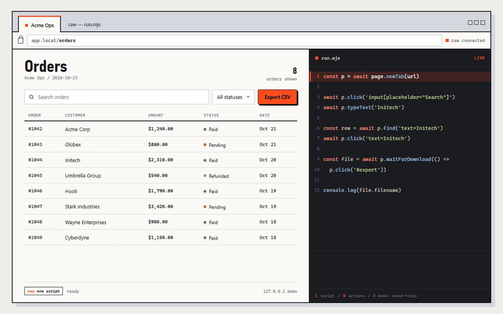
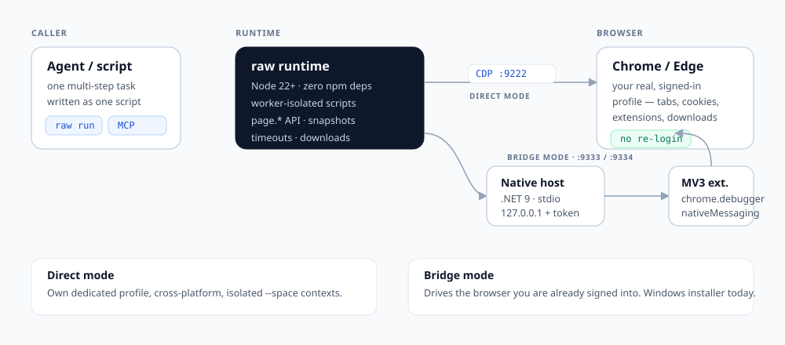

# raw-browser (raw)

**Drive the Chrome or Edge you're already signed into — from one script.**

A zero-dependency browser automation runtime, CLI and MCP server for AI agents.
No fresh profile, no re-login, no `click → look → click` loop.

[](https://github.com/liutingqiu/raw-browser/actions/workflows/ci.yml)
[](https://github.com/liutingqiu/raw-browser/releases)
[](https://nodejs.org/)
[](LICENSE)

English | [简体中文](README.zh-CN.md)



*The demo is one script: snapshot, click, type, select, export. [MP4 version](assets/demo.mp4).*

---

## Quick start

Requires **Node.js 22.21+** and Chrome or Edge.

```bash
git clone https://github.com/liutingqiu/raw-browser.git
cd raw-browser
npm install
npm run build

node dist/browser-cli.js status
node dist/browser-cli.js run -e "const p = await page.newTab('https://example.com'); console.log(await p.title()); await p.closeTab()"
```

In direct CDP mode the first run launches a dedicated browser profile under
`~/.raw/` and keeps it across runs, so logins survive. To put `raw` on your PATH:

```bash
npm link
raw status
```

Want just the CLI and direct CDP mode? Each release also carries a stable
tarball:

```bash
npm install -g https://github.com/liutingqiu/raw-browser/releases/latest/download/raw-browser.tgz
raw status
```

The extension bridge is easiest from a clone, because the installer expects the
repository's `edge-bridge/` layout.

## Why raw-browser

- **Your real browser.** The extension bridge attaches to the Chrome or Edge
  profile you already use. Sessions, cookies and extensions are already there.
- **One script, one task.** A multi-step job is a single JavaScript program with
  loops, conditions and waits — not one model round-trip per click. Fewer
  round-trips, lower cost, less state to re-read.
- **Zero runtime dependencies.** The runtime uses Node's built-in `fetch` and
  `WebSocket`. `npm install` only pulls TypeScript and Node types for
  development.

## One script, one task

```js
const p = await page.newTab('https://app.example.com/orders');

const snapshot = await p.snapshot({ scope: 'viewport' });
console.log(snapshot);                       // numbered elements: [0], [1], …

await p.click('role=button[name="Search"]');
await p.fill('role=textbox', 'Initech');
await p.click('text=Initech');

const file = await p.waitForDownload(() => p.click('text=Export CSV'));
console.log(file.path);                      // orders.csv is on disk
await p.closeTab();
```

Run it from a file:

```bash
node dist/browser-cli.js run < demo/example.mjs
```

or inline:

```bash
raw run -e "const p = await page.newTab('example.com'); console.log(await p.snapshot()); await p.closeTab()"
```

## What's inside

| Area | Capabilities |
|---|---|
| **Locators** | snapshot indices (`#12`), CSS, XPath, `text=`, `:has-text()`, `role=…[name=…]`; open shadow DOM and same-origin iframes |
| **Input** | real CDP mouse/keyboard events, button bitmasks, interpolated drag paths, key chords, file inputs |
| **Rich editors** | Monaco, CodeMirror 5/6, contenteditable and React-controlled fields, with the strategy reported |
| **Waiting** | navigation, popups, downloads, file choosers, DOM mutations, network responses, functions and URLs |
| **Reading** | numbered snapshots, accessibility tree, text/HTML, frames (cross-origin included) |
| **Browser surfaces** | tabs, cookies, proxy, history, bookmarks, extensions, downloads, notifications, CSS injection |
| **Isolation** | `--space` creates a browser context with its own cookies, cache and storage (direct CDP mode) |
| **Agent integration** | CLI, a JavaScript scripting API, and an MCP server with 16 tools |

See [docs/API.md](docs/API.md) for the full scripting reference.

## FAQ

**Is this a Playwright replacement?**
Playwright is a full test framework with its own browser contexts, runner and
assertions. `raw` is a small runtime for agents: it can drive the profile you
are already signed into, and it treats one script as one task. They solve
different problems and can coexist.

**Does it hide automation or bypass bot detection?**
No. There is no stealth patching, no `navigator.webdriver` override and no
fingerprint spoofing. A site that blocks automation will still see a debugger
attached.

**Does it upload cookies or page data?**
No. The runtime and bridge are local-only and bind to `127.0.0.1`. Page content,
and any cookie values a script explicitly requests, go to the calling agent, so
the agent's permission mode is the boundary.

**Which browsers are supported?**
Chrome and Microsoft Edge (Chromium). Direct CDP mode also works with Chromium
builds.

## How it works



There are two ways to reach a browser:

1. **Direct CDP** — `raw` launches a dedicated Chromium profile with
   `--remote-debugging-port` (default `9222`). Cross-platform, isolated spaces,
   no extension required.
2. **Extension bridge** — an MV3 extension uses `chrome.debugger` on real tabs,
   talks to a .NET native-messaging host over stdio, and the host exposes a
   token-protected CDP facade on loopback. Edge uses `9333`, Chrome uses `9334`.
   This is what drives your signed-in profile.

The bridge listener binds to `127.0.0.1` only, requires a per-browser random
token, validates the `Host` header, and refuses a debug port it does not own.
The extension does not copy or log cookies on its own; cookie values are
returned only when a script explicitly calls a cookie API.

## Drive your signed-in browser

The bridge installer is currently Windows PowerShell. Direct CDP mode works on
Windows, macOS and Linux.

```powershell
# Edge + Chrome; use -Browser edge or -Browser chrome for one
powershell -ExecutionPolicy Bypass -File scripts/install-edge-bridge.ps1 -Browser both
```

The installer publishes a self-contained native host, writes independent tokens
to `~/.raw/edge-bridge.json` and `~/.raw/chrome-bridge.json`, and registers the
selected native-messaging hosts. If the .NET 9 SDK is missing, it downloads the
matching prebuilt host from [Releases](https://github.com/liutingqiu/raw-browser/releases)
and verifies `SHA256SUMS.txt` when available. Use `-HostPath <exe>` to install a
host you built yourself, or `-BuildFromSource` to force a local build.

Then load the unpacked extension once per browser:

1. Open `edge://extensions` or `chrome://extensions`.
2. Enable **Developer mode**.
3. Choose **Load unpacked** and select `edge-bridge/extension`.

Select the bridge in `~/.raw/browser-profiles/current.json`:

```json
{ "mode": "edge-extension" }
```

or `{ "mode": "chrome-extension" }`. `raw status` prints the selected bridge,
port and extension version. If the bridge does not connect after an upgrade,
restart the browser once: it caches the native-messaging host path for the life
of the process. Upgrading from an older installer? Restart the browser, then run
the installer once with `-CleanLegacyHosts` to remove the old `host-*`
directories.

## CLI

| Command | Description |
|---|---|
| `raw status` | show the debugger, bridge, profile and browser binary |
| `raw run` | read a script from stdin |
| `raw run -e "<code>"` | run an inline script |

| Option | Description |
|---|---|
| `--timeout-ms N` | script timeout (default `180000`) |
| `--space NAME` | run in an isolated browser context (direct mode) |
| `--headless` | launch headless when the browser is not already running |
| `--profile PATH` | override the persistent profile directory |
| `--port N` | override the CDP port |
| `--browser PATH` | use a specific Chrome or Edge executable |
| `--downloads PATH` | override the download directory |
| `--output-dir PATH` | where inline images are written |

## MCP server

`mcp/raw-browser-mcp.mjs` exposes the runtime as 16 MCP tools: `raw_use`,
`raw_status`, `raw_tabs`, `raw_new`, `raw_goto`, `raw_text`, `raw_html`,
`raw_eval`, `raw_snapshot`, `raw_click`, `raw_fill`, `raw_visit`,
`raw_screenshot`, `raw_cookies`, `raw_frames` and the `raw_call` escape hatch.

```json
{
  "mcpServers": {
    "raw-browser": {
      "type": "stdio",
      "command": "node",
      "args": ["C:/path/to/raw-browser/mcp/raw-browser-mcp.mjs"],
      "env": { "RAW_BRIDGE_BROWSER": "edge" }
    }
  }
}
```

The server remembers the current tab, returns screenshots as image content,
serializes tool calls, and supports cancellation. Set `RAW_CLI` when
`raw-bridge.mjs` is not next to the server, and `RAW_BRIDGE_BROWSER=edge|chrome`
to pick a bridge.

## Security model

- Listeners bind to `127.0.0.1`; remote connections are rejected.
- Every HTTP and WebSocket request needs the per-browser token; comparison is
  constant-time and the `Host` header is validated.
- A debug port that belongs to another process is refused, not reused.
- Scripts run in a worker so a timeout can terminate CPU-bound code. The worker
  is a timeout boundary, **not a security sandbox**.
- `clearBrowsingData` removes only the data types the caller names.
- Page content is untrusted input. Do not feed unvalidated page text into shell
  commands.

`raw` executes model-generated scripts with your operating-system permissions.
The calling agent's prompt and permission mode are the authority for what runs.
See [SECURITY.md](SECURITY.md).

## Testing

```bash
npm run typecheck   # strict TypeScript
npm test            # 51 unit tests
npm run build
npm run smoke:browser
npm run check       # all of the above plus the browser smoke test
```

CI runs the suite on Ubuntu, Windows and macOS across Node 22, 24 and 26, plus a
Windows bridge-host smoke test and a dependency audit.

## Known limitations

1. **The bridge installer is Windows-only today.** Direct CDP mode is
   cross-platform.
2. **One debugger per tab.** Chromium allows a single CDP debugger client per
   tab; concurrent clients detach each other.
3. **No `--space` in bridge mode.** Extensions cannot create an equivalent of
   `Target.createBrowserContext`.
4. **Browser updates can move the ground.** Major Chromium releases occasionally
   change debugger behavior or permission prompts; reload the extension or
   restart the browser after an upgrade.

## Contributing

Issues and pull requests are welcome. See [CONTRIBUTING.md](CONTRIBUTING.md) and
the [changelog](CHANGELOG.md). For security reports, use GitHub's private
vulnerability reporting as described in [SECURITY.md](SECURITY.md).

If raw-browser saves you a few model round-trips, a star helps other people find
it.

## License

[MIT](LICENSE)
