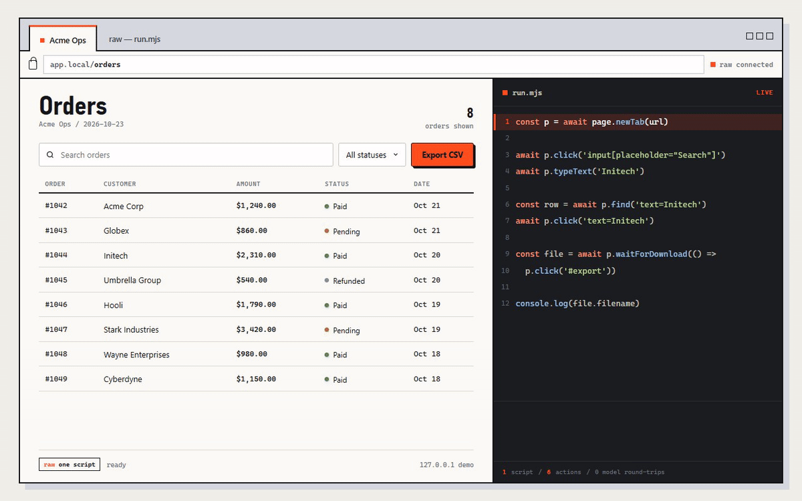
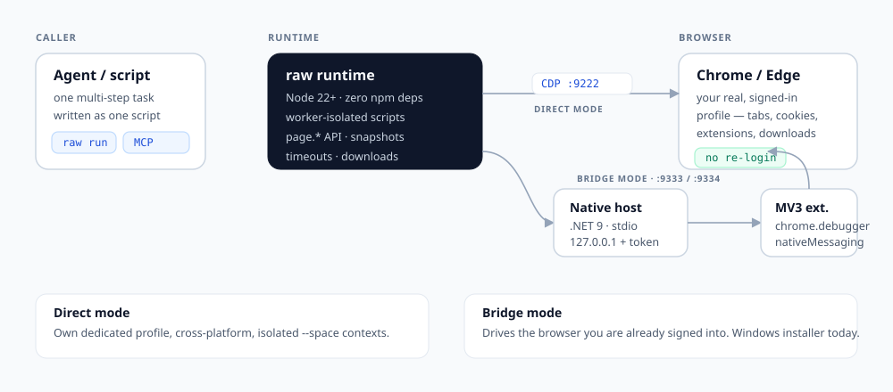

# raw-browser (raw)

**直接驱动你已登录的 Chrome / Edge —— 一段脚本，一个完整任务。**

零运行时依赖的浏览器自动化运行时、CLI 与 MCP server，为 AI Agent 设计。
不新开 profile，不重新登录，不再「点一下 → 看一眼」。

[](https://github.com/liutingqiu/raw-browser/actions/workflows/ci.yml)
[](https://github.com/liutingqiu/raw-browser/releases)
[](https://nodejs.org/)
[](LICENSE)

[English](README.md) | 简体中文



*演示本身就是一段脚本：快照、点击、输入、选择、导出。[MP4 版本](assets/demo.mp4)。*

---

## 它是什么

- **用的是浏览器，不是另开一个浏览器。** 扩展桥直接接在你日常用的 Chrome / Edge
  profile 上，登录态、cookie、扩展都现成。
- **一段脚本，一个任务。** 多步操作写成一个带循环、判断和等待的 JavaScript 程序，
  而不是每点一次就往返模型一次。
- **一层浏览器工具。** CLI、脚本运行时和 stdio MCP server，共 27 个工具：
  导航、读页面、输入、等待、截图、浏览器能力。

它只做浏览器这一层：不是任务调度器，不是终端管理器，也不含模型。

## 快速开始

需要 **Node.js 22.21+**，以及 Chrome 或 Edge。

```bash
npm install -g raw-browser
raw status
raw run -e "const p = await page.newTab('https://example.com'); console.log(await p.title()); await p.closeTab()"
```

直连 CDP 模式下，第一次运行会在 `~/.raw/` 下起一个专属浏览器 profile，
之后一直沿用，登录态不会丢。

从源码装：

```bash
git clone https://github.com/liutingqiu/raw-browser.git
cd raw-browser
npm install
npm run build
npm link
raw status
```

需要固定版本或离线安装时，可以用每个
[release](https://github.com/liutingqiu/raw-browser/releases/latest) 附带的
`raw-browser.tgz`。扩展桥的安装脚本在 npm 包和源码里都有；全局安装后这样跑：
`node "$(npm root -g)/raw-browser/scripts/install-edge-bridge.mjs"`。

## 一段脚本，一个任务

```js
const p = await page.newTab('https://app.example.com/orders');

const snapshot = await p.snapshot({ scope: 'viewport' });
console.log(snapshot);                       // 带编号的元素：[0]、[1]……

await p.click('role=button[name="Search"]');
await p.fill('role=textbox', 'Initech');
await p.click('text=Initech');

const file = await p.waitForDownload(() => p.click('text=Export CSV'));
console.log(file.path);                      // orders.csv 已经落盘
await p.closeTab();
```

从文件跑：

```bash
node dist/browser-cli.js run < demo/example.mjs
```

或者直接内联：

```bash
raw run -e "const p = await page.newTab('example.com'); console.log(await p.snapshot()); await p.closeTab()"
```

## 能力概览

| 方面 | 能力 |
|---|---|
| **定位** | 快照编号（`#12`）、CSS、XPath、`text=`、`:has-text()`、`role=…[name=…]`；开放 shadow DOM 与同源 iframe |
| **输入** | 真实 CDP 鼠标/键盘事件、按键位掩码、带插值的拖拽路径、组合键、文件上传 |
| **富文本编辑器** | Monaco、CodeMirror 5/6、contenteditable、React 受控输入，并回报用的是哪种策略 |
| **等待** | 导航、弹窗、下载、文件选择器、DOM 变化、网络响应、自定义函数与 URL |
| **读取** | 带编号快照、无障碍树、文本/HTML、frame（含跨域） |
| **浏览器能力** | 标签页、cookie、代理、历史、书签、扩展、下载、通知、注入 CSS |
| **隔离** | `--space` 起一个独立 browser context，cookie、缓存、存储互不影响（仅直连模式） |
| **Agent 接入** | CLI、JavaScript 脚本 API、27 个工具的 MCP server |

完整脚本 API 见 [docs/API.md](docs/API.md)。

## 工作原理



两种方式能碰到浏览器：

1. **直连 CDP** —— `raw` 自己起一个专属 Chromium profile，带
   `--remote-debugging-port`（默认 `9222`）。跨平台、支持隔离空间、不需要装扩展。
2. **扩展桥** —— 一个 MV3 扩展用 `chrome.debugger` 操作真实标签页，通过 stdio 跟一个
   .NET 原生宿交通信，宿主只在 loopback 上开一个带 token 的 CDP 门面。Edge 用 `9333`，
   Chrome 用 `9334`。**驱动你已登录 profile 的就是这条路。**

桥只监听 `127.0.0.1`，每个浏览器一把随机 token，校验 `Host` 头，并拒绝不属于自己的调试端口。
扩展本身不会复制或记录 cookie；只有脚本显式调用 cookie API 时才返回具体值。

## 驱动已登录的浏览器

安装脚本支持 Windows、macOS、Linux，直连模式三平台也都能用。

```bash
# 全局 npm 安装（macOS / Linux）
node "$(npm root -g)/raw-browser/scripts/install-edge-bridge.mjs" --browser both

# 源码克隆（任意平台）
node scripts/install-edge-bridge.mjs --browser both
```

Windows 上这条 Node 命令会自动转到 PowerShell 脚本；也可以直接跑它：

```powershell
powershell -ExecutionPolicy Bypass -File "$(npm root -g)\raw-browser\scripts\install-edge-bridge.ps1" -Browser both
```

安装器会发布一个自包含的原生宿主，把两把互相独立的 token 写进
`~/.raw/edge-bridge.json` 和 `~/.raw/chrome-bridge.json`，并注册对应的
native messaging 宿主：Windows 走 HKCU，macOS 放在
`~/Library/Application Support` 下的 `NativeMessagingHosts`，Linux 放在 `~/.config` 下。
如果本机没有 .NET 9 SDK，它会从 [Releases](https://github.com/liutingqiu/raw-browser/releases)
下载对应平台的预编译宿主，并在有 `SHA256SUMS.txt` 时校验。
想装自己编译的宿主用 `--host-path`，强制本地编译用 `--build-from-source`。

宿主固定放在 `~/.raw/edge-bridge/current/`，这样升级时 native messaging 清单不用改路径；
安装器原地替换可执行文件，并保留上一份用于回滚。

浏览器和宿主必须在同一个操作系统里。Windows 的 Chrome 用不了装在 WSL 里的宿主：
要么给 Windows 浏览器跑 Windows 版安装器，要么在 WSL（带 WSLg）里装一个 Linux 版
Chrome/Edge 再在那儿跑安装器。Snap / Flatpak 沙箱里的浏览器读不到安装器写的用户级
native messaging 目录，桥接要用 deb/rpm 或 app bundle 安装的浏览器。

然后每个浏览器加载一次扩展：

1. 打开 `edge://extensions` 或 `chrome://extensions`。
2. 打开「开发者模式」。
3. 点「加载解压缩的扩展」，选安装器输出的 `ExtensionPath`（源码里是
   `edge-bridge/extension`）。

在 `~/.raw/browser-profiles/current.json` 里选定走哪座桥：

```json
{ "mode": "edge-extension" }
```

或者 `{ "mode": "chrome-extension" }`。`raw status` 会打印当前选的桥、端口和扩展版本。
升级后如果桥连不上，重启一次浏览器：它在进程生命周期内缓存了 native messaging 宿主的路径。
从老版本安装器升上来？先重启浏览器，再带 `--clean-legacy-hosts`（PowerShell 里是
`-CleanLegacyHosts`）跑一次安装器，清掉旧的 `host-*` 目录。

## CLI

| 命令 | 说明 |
|---|---|
| `raw status` | 显示调试端口、桥、profile 和浏览器可执行文件 |
| `raw run` | 从 stdin 读脚本执行 |
| `raw run -e "<code>"` | 执行一段内联脚本 |

| 选项 | 说明 |
|---|---|
| `--timeout-ms N` | 脚本超时（默认 `180000`） |
| `--space NAME` | 在独立 browser context 里跑（仅直连模式） |
| `--headless` | 浏览器没在跑时用 headless 启动 |
| `--profile PATH` | 覆盖持久化 profile 目录 |
| `--port N` | 覆盖 CDP 端口 |
| `--browser PATH` | 指定 Chrome / Edge 可执行文件 |
| `--downloads PATH` | 覆盖下载目录 |
| `--output-dir PATH` | 内联图片写到哪儿 |

另外还有 `raw-bridge.mjs`，就是 MCP server 驱动的那个单命令 JSON 门面
（`tabs`、`goto`、`eval`、`snapshot`、`click`、`fill`、`press`、`scroll`、
`screenshot`、`cookies`、`frames`、`call` 等）。每条命令都输出 JSON，退出码有意义。

## MCP server

`npm install -g raw-browser` 会一并装上 `raw-mcp`，一个 stdio MCP server，把运行时
暴露成 27 个工具：

`raw_use`、`raw_status`、`raw_tabs`、`raw_claim`、`raw_release`、`raw_close`、
`raw_clone`、`raw_approve`、`raw_new`、`raw_goto`、`raw_text`、`raw_html`、
`raw_eval`、`raw_snapshot`、`raw_click`、`raw_fill`、`raw_press`、`raw_select`、
`raw_scroll`、`raw_wait`、`raw_group`、`raw_run`、`raw_visit`、`raw_screenshot`、
`raw_cookies`、`raw_frames`，以及逃生舱 `raw_call`。

```json
{
  "mcpServers": {
    "raw-browser": {
      "type": "stdio",
      "command": "raw-mcp",
      "env": { "RAW_BRIDGE_BROWSER": "edge" }
    }
  }
}
```

从源码跑的话，直接指向 `mcp/raw-browser-mcp.mjs`：

```json
{
  "mcpServers": {
    "raw-browser": {
      "type": "stdio",
      "command": "node",
      "args": ["C:/path/to/raw-browser/mcp/raw-browser-mcp.mjs"],
      "env": { "RAW_BRIDGE_BROWSER": "edge" }
    }
  }
}
```

server 会记住当前标签页，截图以 image 内容返回，工具调用串行执行，并支持取消。
`raw-bridge.mjs` 不在 server 旁边时用 `RAW_CLI` 指定，用
`RAW_BRIDGE_BROWSER=edge|chrome` 选桥。这个 server 已收录进
[HOL Guard](https://github.com/hashgraph-online/hol-guard) 的 MCP 目录（条目名
`mcp.raw-browser`）：只读工具走普通策略，导航、输入和读 cookie 需要审核，
`raw_eval` / `raw_call` 直接拦掉。

### 标签页归属

多个 Agent 可以共用一个浏览器而不抢标签页。每个 Agent 认领自己的标签页，而且
**Agent 的标签页一律后台打开**：人看他的页面，焦点不被打断。`raw_claim` 会开一个
标签页（或者接管指定的那个），记下模型起的 label（显示在标签页横幅和 `raw_tabs` 里），
并**把它收进一个 Chrome 标签组**——按任务分组，组名由模型通过 `group` 指定
（默认用 label）。哪怕只有一个标签页也会分组，这样 Agent 的页和人的页永远分得开。

Agent 之间可以配合，但是只读：显式传别的 Agent 的 `tabId` 可以读
（`raw_text`、`raw_html`、`raw_snapshot`、`raw_screenshot`、`raw_frames`），
结果里会带一行 `[note: tab ... belongs to "..."]`。任何会改动页面的动作——
`click`、`fill`、`press`、`select`、`scroll`、`eval`、`goto`——在别人的页上会被拒，
并提示用 `raw_clone` 把 URL 和滚动位置复制成一个归自己的新标签页。
只有「不传 tabId」的隐式目标被限制在自己的页里，所以不会有操作悄悄落到别人页面上；
`raw_goto` 在自己没有页时会新开一个。`raw_tabs` 是只读的，按页报告 `owner` / `owned`。
`raw_release` 归还标签页；`raw_close` 关掉它，关别人的页需要 `force: true`。
改名不会丢已经认领的页。`raw_group` 可以重新分组、`ungroup: true` 去掉分组装饰、
`close: true` 在任务结束时关掉整组——用不上的页要及时关，多 Agent 并行时尤其如此。
（升级后需要重新加载一次扩展：它新声明了 `tabGroups` 权限。）
归属信息存在 `$RAW_HOME/tab-owners-<browser>.json`，所有 Agent 进程共享。
`raw_call` 是受信任的逃生舱，不做归属校验。

### 用代码驱动

`raw_run` 接收一段绑定在当前 Agent 标签页上的 JavaScript：
`page.goto/click/fill/press/scroll/select/text/html/eval/snapshot/screenshot/waitFor`，
外加 `sleep` 和 `console`。一次调用就能填表、提交、读结果，而不是来回十几趟。

### 站点授权

桥驱动的是人已登录的 profile，所以导航可以要求人工确认。
`$RAW_HOME/permissions.json` 默认是 `{"defaultAccess": "allow"}`；
可以设成 `"ask"` 或 `"deny"`，也可以按 origin 固定：

```json
{
  "defaultAccess": "ask",
  "origins": { "https://github.com": { "access": "allow" } }
}
```

设成 `ask` 后，导航会返回一个带 origin 的错误；人同意之后调用
`raw_approve { "origin": "https://example.com", "scope": "session" }` 放行本次进程，
`scope: "persistent"` 则写进文件长期生效。

## 常见问题

**它是 Playwright 的替代品吗？**
Playwright 是完整的测试框架，自带 browser context、runner 和断言。`raw` 是给 Agent 用的
小型运行时：它能驱动你已登录的 profile，并且把一段脚本当作一个任务。
两者解决的问题不同，可以并存。

**它会隐藏自动化痕迹或绕过反爬吗？**
不会。没有 stealth 补丁，不覆盖 `navigator.webdriver`，也不伪造指纹。
会挡自动化的站点照样能看见一个调试器挂着。

**它会上传 cookie 或页面数据吗？**
不会。运行时和桥都是本地的，只绑 `127.0.0.1`。页面内容和脚本显式请求的 cookie 值
只发给调用它的 Agent，所以 Agent 的权限模式就是边界。

**支持哪些浏览器？**
Chrome 和 Microsoft Edge（Chromium）。直连模式也支持其它 Chromium 构建。

**它会帮我拆分和调度任务吗？**
不会。`raw` 只执行浏览器操作。规划、任务队列和汇报交给驱动它的 Agent 运行时——
这个边界是刻意划的。

## 安全模型

- 监听只绑 `127.0.0.1`，远端连接直接拒绝。
- 每个 HTTP 和 WebSocket 请求都要带对应浏览器的 token；比较是常量时间的，
  并且校验 `Host` 头。
- 属于别的进程的调试端口会拒绝使用，不会复用。
- 脚本跑在 worker 里，所以超时能杀掉 CPU 死循环。这个 worker 是**超时边界，
  不是安全沙箱**。
- `clearBrowsingData` 只清理调用方点名的数据类型。
- 页面内容是不可信输入。不要把未校验的页面文本拼进 shell 命令。

`raw` 会以你的操作系统权限执行模型生成的脚本。调用它的 Agent 的提示词和权限模式，
决定了到底能跑什么。详见 [SECURITY.md](SECURITY.md)。

## 测试

```bash
npm run typecheck   # 严格 TypeScript
npm test            # 83 个单元与集成测试
npm run build
npm run smoke:browser
npm run check       # 上面全部，外加真浏览器 smoke
```

CI 在 Ubuntu、Windows、macOS 上跑 Node 22 / 24 / 26，另外还有三平台的原生宿主 smoke
和依赖审计。

## 已知限制

1. **native messaging 要求桌面浏览器在同一个系统里。** 安装器覆盖 Windows、macOS、
   Linux 上稳定版的 Chrome 和 Edge；Snap/Flatpak 沙箱浏览器、以及 WSL 到 Windows
   浏览器的组合不在支持范围。
2. **一个标签页一个调试器。** Chromium 只允许一个 CDP 客户端连同一个标签页，
   多个客户端会互相踢掉。
3. **桥模式没有 `--space`。** 扩展造不出 `Target.createBrowserContext` 的等价物。
4. **浏览器升级会改变地基。** Chromium 大版本偶尔会改调试器行为或权限提示；
   升级后重新加载扩展或重启浏览器。

## 参与贡献

欢迎提 issue 和 PR，见 [CONTRIBUTING.md](CONTRIBUTING.md) 和
[更新日志](CHANGELOG.md)。安全问题请走 GitHub 的私密漏洞报告，方式见
[SECURITY.md](SECURITY.md)。

如果 raw-browser 帮你省了几趟模型往返，点个 star 能让更多人找到它。

## 致谢

raw-browser 的 API 和产品思路参考了这些先行者：

- [Playwright](https://github.com/microsoft/playwright)（Apache-2.0）：
  locator 与自动等待模型塑造了 `page.*` 的接口。
- [ego-lite](https://github.com/CitroLabs/ego-lite)（MIT）：
  共享浏览器的 Spaces 和已登录 profile 的思路影响了隔离设计。

raw-browser 是直接基于 Chrome DevTools Protocol 的独立实现，没有把上面任何一个
列为依赖。

## 开源许可

[MIT](LICENSE)
